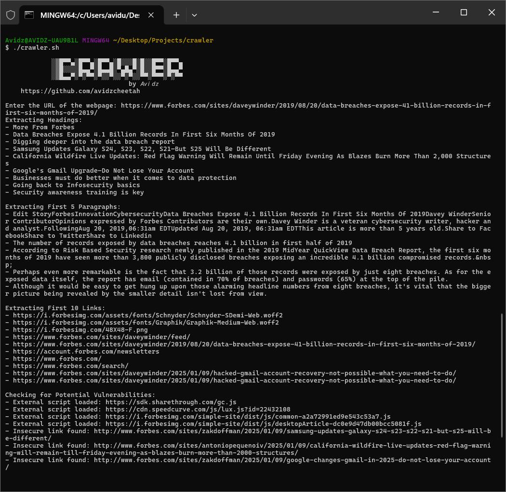

# 🛡️ AI-Powered Advanced Web Crawler & Scanner v2.0



A high-performance, AI-driven security tool designed for deep recursive crawling and vulnerability analysis. Recreated from the original `crawler.sh` using modern web technologies, Playwright, and the official Google Gemini (`google-genai`) SDK.

---

## 📖 Complete Guide

### 1. Prerequisites
Before running the scanner, ensure you have the following installed:
- **Python 3.8 or higher**: Required for the core scanning engine.
- **Git Bash (Windows) / Zsh / Bash**: Required to run the `crawler.sh` wrapper.
- **Internet Connection**: Required for fetching pages and AI analysis.

### 2. Installation
Clone the repository and navigate to the directory:
```bash
git clone https://github.com/avidzcheetah/bash-web-crawler.git
cd bash-web-crawler
```

### 3. Configuration (AI Features)
To enable AI-powered vulnerability validation and reduce false positives:
1. Obtain a **Gemini API Key** from [Google AI Studio](https://aistudio.google.com/).
2. Create a file named `.env` in the root folder.
3. Add your key to the file:
   ```env
   GEMINI_API_KEY=your_actual_api_key_here
   ```
*Note: If no key is provided, the scanner will still work but will skip the deep AI validation step.*

### 4. Running the Scanner
The `crawler.sh` script is an intelligent wrapper. On its first run, it will automatically:
- Create a Python virtual environment (`venv`).
- Install all required dependencies (`google-genai`, `playwright`, `beautifulsoup4`, etc.).
- Download the necessary **Chromium** browser binaries directly into a local `pw-browsers` folder for isolated execution.

**Basic Usage:**
```bash
./crawler.sh https://example.com
```

**Advanced Usage:**
```bash
./crawler.sh -p 20 -o my_report https://target-site.com
```

### 5. CLI Options
| Option | Long Flag | Description | Default |
| --- | --- | --- | --- |
| `-p` | `--pages` | Maximum number of internal pages to crawl | `10` |
| `-o` | `--output` | Filename for the generated reports (no extension) | `scan_report` |
| `-v` | `--verbose` | Show detailed execution logs | `Disabled` |
| `-h` | `--help` | Display the help message | `-` |

### 6. Troubleshooting
**Playwright Browser Issues (Missing Executable):**
If the script fails to launch the browser or reports a missing executable, the automated setup might have been interrupted. To fix this manually:
1. Activate the virtual environment: `source venv/Scripts/activate` (Windows) or `source venv/bin/activate` (Mac/Linux).
2. Run: `export PLAYWRIGHT_BROWSERS_PATH="$PWD/pw-browsers"` (or similar depending on your OS).
3. Run: `playwright install chromium`

### 7. Understanding the Output
After the scan completes, two files will be generated in the current directory:
- **`[filename].json`**: Raw JSON data containing all findings, ideal for integration with other security tools.
- **`[filename].md`**: A beautifully formatted summary of all findings, sorted by severity (Critical to Info), including specific code snippets and AI analysis justifications.

## 🚀 Key Features
- **Deep Crawling**: Uses Playwright to navigate complex Single Page Applications (SPAs) and JavaScript-rendered content that standard `curl`-based crawlers miss.
- **Smart Analysis**: Built-in heuristic modules for detecting SQLi, XSS, insecure forms, and Open Redirects.
- **AI Validation Engine**: Utilizes the modern `google-genai` SDK and the `gemini-2.5-flash` model to analyze context, dramatically reducing false positives by confirming if a heuristic flag is an actual risk.
- **Automatic Categorization**: Vulnerabilities are ranked as **Critical, High, Medium, Low, or Info**.
- **Cross-Platform Compatibility**: Enhanced bash wrapper specifically designed to resolve Windows/Unix path collisions in Git Bash environments.

---
*Developed with ❤️ by Avidz*
